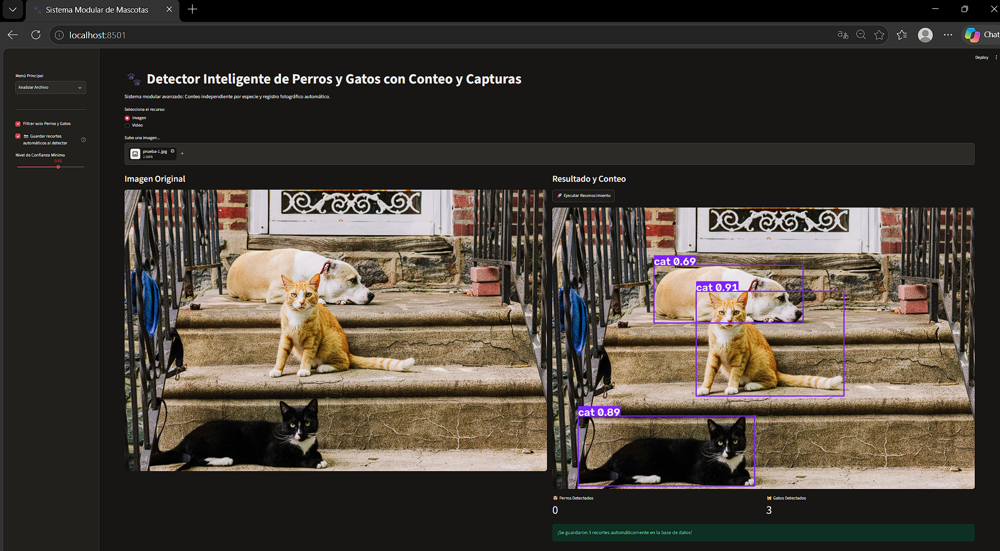

# Deteccion_gatos_perros
Sistema para la detección de perros y gatos por medio de IA.
# 🐾 Sistema Inteligente de Detección y Conteo de Animales (Streamlit + YOLOv8)

Aplicación web modular desarrollada en Python para la detección, conteo y registro automático de animales (mascotas y fauna silvestre) en imágenes y videos, utilizando **YOLOv8** personalizado y una interfaz interactiva de **Streamlit**.

---

## 🚀 Características Principales

* **Interfaz Web Intuitiva:** Desarrollada con Streamlit para la carga dinámica de archivos (imágenes y videos) y visualización en tiempo real.
* **Modelo de IA Personalizado:** Integración de un modelo YOLOv8 entrenado a medida (`best.pt`) para optimizar la detección en entornos complejos y de campo (cámaras trampa).
* **Gestión y Almacenamiento Automático:** Recorte automático de los animales detectados y persistencia de datos mediante **SQLite**.
* **Métricas Dinámicas:** Conteo automático de clases en tiempo real con barras de confianza configurables.
* **Historial Multimedia:** Registro detallado de archivos subidos y capturas guardadas.

---

## 📁 Estructura del Proyecto

```text
detector_mascotas/
│
├── .venv/                   # Entorno virtual de Python
├── storage_capturas/        # Recortes automáticos de animales detectados
├── storage_media/           # Archivos originales subidos (imágenes/videos)
├── ai_model.py              # Lógica de inferencia con YOLOv8 y procesamiento OpenCV
├── app_ui.py                # Interfaz de usuario (Streamlit)
├── database.py              # Configuración y operaciones con SQLite
├── best.pt                  # Pesos del modelo YOLOv8 personalizado
├── historial_animales.db    # Base de datos SQLite
└── README.md                # Documentación del proyecto

🛠️ Requisitos del Sistema y Dependencias
 -Python 3.8 o superior.
- Librerías principales:
    streamlit
    ultralytics
    opencv-python
    numpy
    Pillow

⚙️ Instalación y Configuración Local
    1. Clona este repositorio:
       git clone [https://github.com/tu-usuario/detector_mascotas.git](https://github.com/tu-usuario/detector_mascotas.git)cd detector_mascotas

    2. Crea y activa el entorno virtual:
        
       En Windows (PowerShell):
         python -m venv .venv.\.venv\Scripts\Activate

    3. Instala las dependencias:
       pip install streamlit ultralytics opencv-python numpy pillow

▶️ Ejecución de la Aplicación
Para poner en marcha el servidor local de Streamlit, ejecuta:
 streamlit run app_ui.py


Abre el enlace local que aparece en la terminal (usualmente http://localhost:8501) en tu navegador web.

💡 Uso

Selecciona el modo en el menú lateral (Analizar Archivo, Historial Multimedia o Galería de Capturas).
Ajusta el Nivel de Confianza Mínimo mediante el control deslizante.
Sube una imagen o video y haz clic en Ejecutar Reconocimiento.


